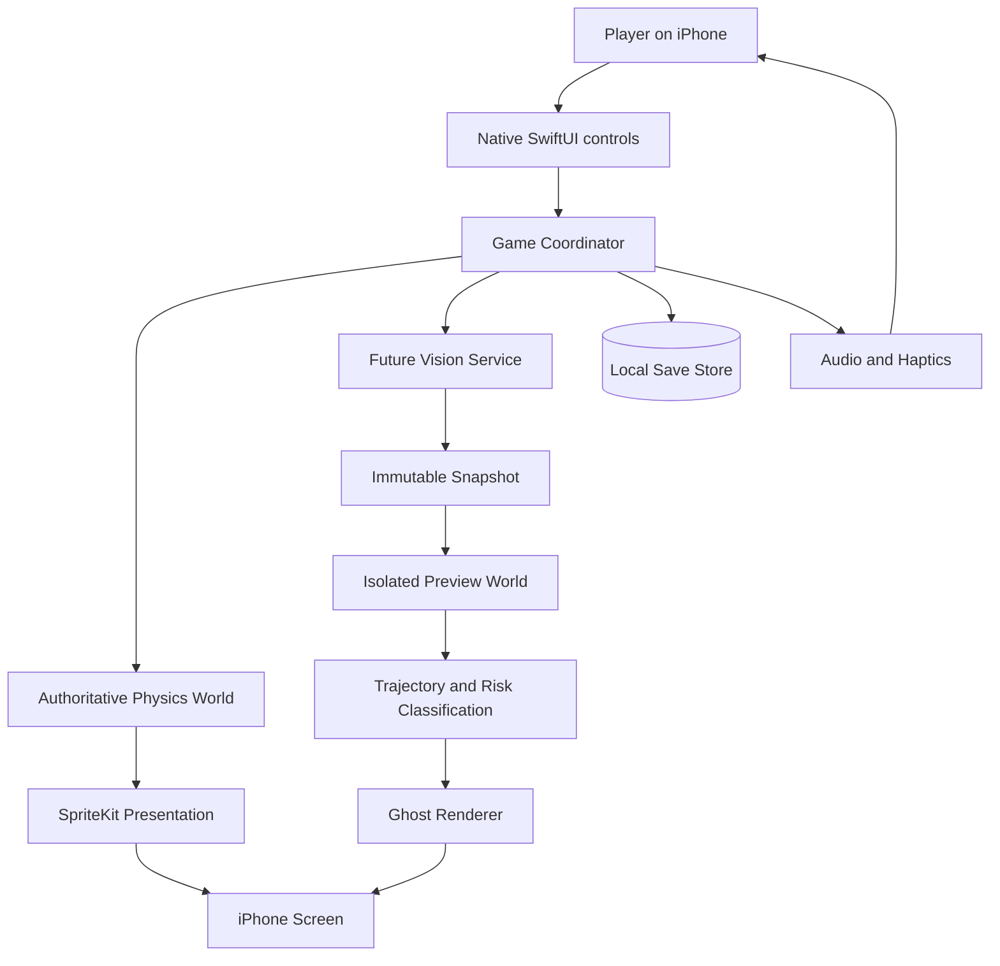
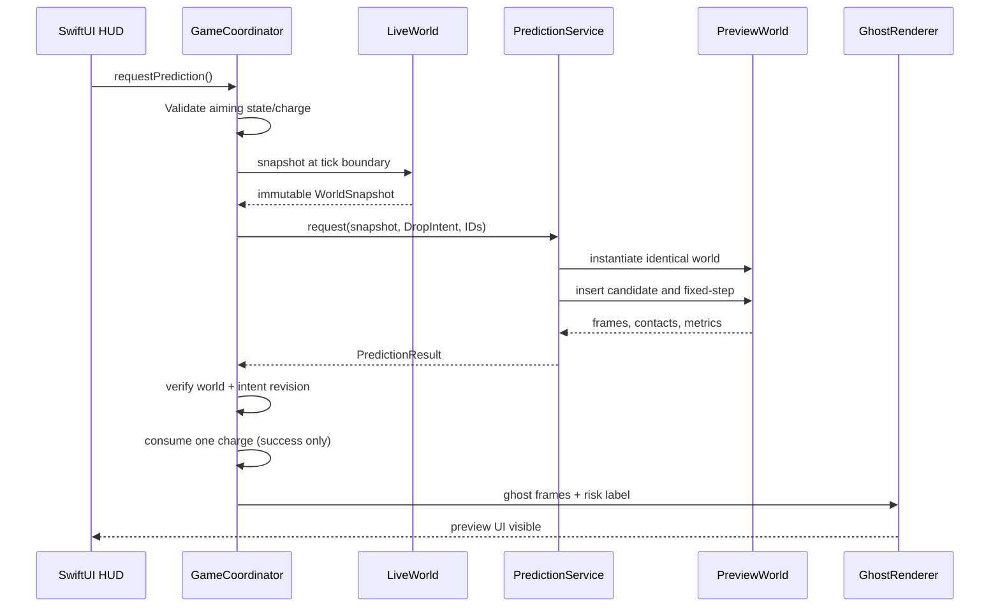

# Stackcident — Technical Architecture
**Document ID:** STK-ARC-001  
**Version:** 1.0 | **Date:** 2026-10-29 | **Status:** Proposed architecture, not implemented  
**Repository:** `komail2004/Stackcident` | **Target:** native **iPhone-only iOS application**  
**Related:** [Overview](../overview.md) · [Functional & Non-Functional Requirements](../requirements.md)

> **Architectural mandate:** Stackcident is an actual Swift/Xcode iOS game, not a web game. It runs offline, with one authoritative physics world and a separate, isolated prediction world. Its differentiating Future Vision mechanic must be physics-derived, testable, and honest about prediction limits.

---

## 1. Purpose, scope and decision hierarchy

This document specifies executable component boundaries, data contracts, simulation determinism strategy, concurrency, persistence, security, test architecture, release pipeline and risk-managed implementation order. It is the proposed blueprint for future code—not a statement that code exists.

**Source of truth precedence:** `requirements.md` for mandatory acceptance behavior; this document for proposed implementation; `overview.md` for product intent. If architecture must violate a requirement, write an Architecture Decision Record (ADR), update requirements, and obtain explicit project approval before implementation.

**V1 scope:**
- Native Swift / SwiftUI iPhone app, portrait-first.
- 2D rigid-body stacking, explicit positioning/rotation and Drop action.
- Three Future Vision charges per run; no paid competitive advantage.
- Live physics state isolated from preview; recorded ghost replay.
- Local persistence and settings, offline play, on-device tests, TestFlight/App Store path.
- No backend, third-party tracking or generative AI runtime required.

**Out of scope for V1:** Android, PWA, Vercel gameplay hosting, shared cloud game state, online multiplayer, Game Center (future option), daily seeded challenges (future option), in-game chat, live LLM calls and trained ML predictions.

### 1.1 Quality priorities (descending)
1. Prediction cannot mutate or corrupt live game state.
2. Physics and preview must agree sufficiently to earn player trust.
3. Gameplay must remain responsive and stable on physical iPhones.
4. Stacking must feel fun and fair.
5. Code must be maintainable and testable.
6. Art polish and optional integrations follow core correctness.

### 1.2 Decision statuses
- **Accepted architectural constraint:** native iOS, offline-first, separate prediction world, single authoritative live world, no misleading AI claims.
- **Provisional implementation choice:** SwiftUI app shell, SpriteKit rendering, controlled physics engine integration.
- **Unresolved gate:** actual physics engine and snapshot/determinism approach, min iOS target, exact physical device matrix, final frame/latency thresholds based on measurement.
- **Prohibited shortcut:** filming or synthesizing a fake prediction instead of simulating the intended drop.

---

## 2. System context and boundaries



The game itself is self-contained on the phone. Apple distribution and optional StoreKit transactions may contact Apple services, but ordinary play must not.

**Trust boundaries:**
- SwiftUI controls are **commands**, not a source of physics truth.
- Only `LiveWorld` commits authoritative transforms and scores.
- A `PreviewWorld` is expendable and read-only with respect to live state.
- Persisted saves are untrusted inputs after loading and must be validated/migrated.
- Future optional Apple/network integrations live behind separate adapters, not core simulation.

---

## 3. iOS-specific app composition

### 3.1 Boot and lifecycle
```text
@main StackcidentApp (SwiftUI)
  └── WindowGroup
      └── AppRootView
          ├── Navigation/Presentation state
          ├── Home / Tutorial / Settings / Results (SwiftUI)
          └── GameplayContainer
              ├── SwiftUI HUD and touch controls
              └── SpriteView rendering a SpriteKit scene
```

Use `scenePhase` and relevant UIKit lifecycle bridges for pause/resume, interruption and memory-pressure policies. Account for Dynamic Island/notch and home indicator, device safe areas, audio session interruptions, haptics availability and system Reduce Motion.

Do not embed gameplay in `WKWebView`; this is not a hybrid web app.

### 3.2 Presentation separation
- **SwiftUI:** screens, menus, settings, tutorial prompts, gameplay HUD, rotate/drop/preview buttons, accessible controls, purchase UI if adopted.
- **SpriteKit:** objects, tower, camera, contacts represented visually, particles, ghost frame interpolation.
- **Physics adapter:** all actual rigid-body calculations, stepping and world serialization. Renderer consumes data; it does not own canonical physics state.
- **Coordinator/ViewModel:** maps player commands to rules and physics; publishes immutable render snapshots for SwiftUI/SpriteKit.
- **Audio/Haptics:** interface triggered by domain events; no control over game rules.

**Caution:** SpriteKit's `SKPhysicsWorld` is convenient for gameplay but exposes neither a straightforward complete world clone nor an independent manual stepping API equivalent to a fully controlled solver. Choosing SpriteKit physics directly requires a parity prototype. A separate controllable simulation library for both live and preview is likely a better long-term boundary if precise cloned-world stepping is essential. Never combine SpriteKit live physics with a mathematically different preview approximation and claim identical outcomes.

### 3.3 Threading and actor ownership
- SwiftUI observable UI state and rendering commands live on `@MainActor`.
- The authoritative simulation has **single-owner serialized mutation**, independent of UI rendering, with a fixed tick.
- Prediction computation runs off the main actor on a **private world instance**, using `Sendable` immutable input and output where compiler support allows.
- No SpriteKit node or mutable UIKit/SwiftUI objects are passed into a background prediction worker.
- A prediction task is cancellable; cancellation cannot affect the live world.
- Frame snapshots passed to renderers are copies or immutable values. Avoid unsynchronized direct reads of simulation memory.
- iOS backgrounding stops or cancels simulation work according to an explicit lifecycle policy; do not rely on unrestricted background CPU time.

---

## 4. Modules and responsibilities

| Module | Responsibility | Explicitly cannot do |
|---|---|---|
| AppShell | SwiftUI app lifecycle, navigation, dependency wiring | Apply forces or update scores |
| GameCoordinator | State-machine transitions, commands, sequencing, error handling | Implement collision resolution |
| GameRules | Score, settlement/loss, progression and charge economics | Render SpriteKit nodes |
| ObjectCatalog | Immutable object definitions and collision configuration | Store mutable current transforms |
| PhysicsCore | Create/step/destroy worlds; body dynamics and contacts | Own HUD or purchases |
| LiveSimulation | Authoritative physics state and current tick | Reuse preview's mutable world |
| SnapshotCodec | Validated serialization/restoration of complete required state | Quietly omit unsupported constraints |
| PredictionService | Clone/simulate intended drop and return recorded frames | Mutate live world, score or saves |
| PredictionClassifier | Convert trajectory/contact outcomes into explainable labels | Fabricate likelihood percentages |
| SpriteSceneAdapter | Draw current authoritative frame and effects | Derive score or alternate physics |
| GhostOverlay | Draw replay of simulated future with correct label | Replace live objects with ghosts |
| InputController | Validate/normalize touch gestures and button commands | Commit a drop on aiming-only gesture |
| GameSaveStore | Versioned local settings/bests and optional safe snapshots | Cloud sync without separate consent/decision |
| SoundHaptics | Material impacts and optional vibrations | Block gameplay on audio failures |
| Diagnostics | Debug timings, parity traces and fixtures | Export personal data by default |
| PurchaseAdapter (conditional) | StoreKit 2 entitlements and restore | Alter competitive prediction physics |

### 4.1 Dependency rule
The dependency graph points inward:

```text
iOS App / SwiftUI / SpriteKit / StoreKit adapters
                 ↓
      GameCoordinator + Services
                 ↓
       Domain Models + Rules
                 ↓
         Physics Protocols
                 ↑
       Concrete Physics Engine
```

Domain and simulation protocols shall not import SwiftUI or SpriteKit. A physics implementation can be swapped if parity tests fail without rewriting every gameplay screen.

---

## 5. State model, commands and events

### 5.1 State machine
```text
menu → tutorial? → aiming → predicting? → aiming → dropping → settling
                                                 ↘ lost → results → restart → aiming
                                            settled-success → aiming
any active state → paused → prior compatible state
```

Define the authoritative enumeration and transition table centrally. Presentation animations never decide whether a round ended.

### 5.2 Command/event contract
Examples:
```swift
enum GameCommand: Sendable {
    case startRound(seed: UInt64)
    case moveCandidate(x: Double)
    case rotateCandidate(deltaRadians: Double)
    case requestPrediction
    case cancelPrediction
    case commitDrop
    case pause
    case resume
    case restart
}

enum GameEvent: Sendable {
    case candidateChanged(revision: UInt64)
    case predictionStarted(requestID: UUID)
    case predictionReady(requestID: UUID)
    case predictionFailed(requestID: UUID, reason: PredictionError)
    case objectSettled(id: BodyID)
    case runEnded(score: Int)
}
```

Type sketch only: real implementation should use concrete validated types and careful `Sendable` conformance.

### 5.3 State ownership
`RoundState` owns score, offered object, prediction charges, current run seed, rules version, and game phase. `LiveWorld` owns dynamic body state and simulation clock. `UIState` owns display-only overlays and animation progress.

A **world revision** changes whenever any gameplay state that can alter predictions changes (simulation tick, impulses, new bodies, changes to rules/config, etc.). An **intent revision/fingerprint** changes on every relevant placement or rotation. Results are accepted only if both revisions and request ID match the request that produced them.

---

## 6. Physics architecture and solver selection

### 6.1 Design rule
**One physics implementation, two physically separate world instances.** A single ruleset must drive both actual dropping and Future Vision.

### 6.2 Selection candidates

| Choice | Strengths | Risks | Decision |
|---|---|---|---|
| SpriteKit `SKPhysicsWorld` for both | Excellent iOS tooling and fast rendering integration | Limited complete state clone/manual stepping/determinism controls | Prototype only until parity measured |
| SpriteKit renderer + Box2D-style controllable 2D physics | Explicit world creation and step API; potentially easier headless snapshots/tests | Swift/C++ integration, licensing and contact-cache details | Preferred investigation path |
| Custom 2D solver | Total control | Very high implementation and validation burden | Do not select without compelling evidence |

**No engine is certified yet.** Before creating production classes, prove a multi-contact scene preview and authoritative drop yield acceptable agreement. A state reconstruction from body transforms may still diverge due to cached contacts/warm starting and solver order. Plan tests that capture that limitation.

### 6.3 Units and coordinate transforms
- Domain physics units in **meters, kilograms, seconds, radians** (conceptually scaled toy-world units).
- Rendering in screen points; an explicit configurable `pixelsPerMeter` transform converts, never embedded ad hoc.
- Domain origin and positive axes documented (recommend physics origin bottom-center with +Y upward); screen conversion handles SpriteKit coordinates and camera scroll.
- Geometry, mass, inertia and center-of-mass handling must be stable and validated at import.
- Use one documented fixed timestep, candidate `1/60 s`, and explicit max ticks per visual frame. Never accelerate physics merely because rendering lagged.
- At a missed rendering deadline, allow frame interpolation or safe step catch-up within limits; record overload.

### 6.4 Object data contract
```swift
struct BodyID: Hashable, Codable, Sendable { let rawValue: UInt64 }
struct Vec2: Codable, Sendable { var x: Double; var y: Double }

struct BodyState: Codable, Sendable {
    let id: BodyID
    let definitionID: String
    var position: Vec2
    var angleRadians: Double
    var linearVelocity: Vec2
    var angularVelocity: Double
    var isAwake: Bool
}

struct WorldSnapshot: Codable, Sendable {
    let schemaVersion: UInt16
    let physicsEngineVersion: String
    let worldRevision: UInt64
    let tickIndex: UInt64
    let rngState: UInt64
    let worldConfig: WorldConfig
    let bodies: [BodyState]
    let constraints: [ConstraintState]
    let engineOpaqueState: Data? // only if supported/needed and validated
}
```

This is a **conceptual minimum**, not a complete snapshot contract. Real snapshots must also represent body physical properties and fixtures (or reference immutable versioned catalog definitions), collision filtering, solver/contact state when required, external forces, joint/motor states, sleeping rules, moving platform phase, spawn configuration and outstanding impulses. If any required element cannot be captured faithfully, the service must reject or label the prediction uncertain rather than fabricate accuracy.

### 6.5 World adapter protocol
```swift
protocol PhysicsWorld {
    func createWorld(config: WorldConfig) throws
    func instantiate(snapshot: WorldSnapshot) throws
    func captureSnapshot() throws -> WorldSnapshot
    func addBody(definition: ObjectDefinition, pose: Pose) throws -> BodyID
    func step(fixedDelta: Double) throws -> PhysicsStepOutput
    func readFrame() -> WorldFrame
    func destroy()
}
```
For actor isolation and performance, the concrete interface may use an owning actor or synchronous methods executed on a dedicated serial context. Do not expose a mutable world object across actors.

### 6.6 Contacts and loss
A `PhysicsStepOutput` contains timestamped body transforms, collisions/contact events, sleeping state and bounds checks. `GameRules` interprets it to decide:
- Valid place/settle.
- How score increments.
- Whether critical bodies leave the support area.
- Whether the loss threshold is reached.
- What feedback to emit.

All thresholds belong to a versioned `RulesConfig`, not magic numbers in UI callbacks.

---

## 7. Future Vision pipeline — implementation contract

### 7.1 Request lifecycle


### 7.2 Structural contracts
```swift
struct DropIntent: Sendable {
    let candidateDefinitionID: String
    let position: Vec2
    let angleRadians: Double
    let releaseVelocity: Vec2
    let intentRevision: UInt64
}

struct PredictionRequest: Sendable {
    let requestID: UUID
    let snapshot: WorldSnapshot
    let intent: DropIntent
    let horizonTicks: Int
}

enum RiskLabel: String, Sendable {
    case stable, wobbly, collapseRisk, uncertain
}

struct PredictionResult: Sendable {
    let requestID: UUID
    let worldRevision: UInt64
    let intentRevision: UInt64
    let frames: [WorldFrame]
    let label: RiskLabel
    let horizonTicks: Int
    let simulationDurationMilliseconds: Double
}
```

All types above are design sketches, not compiled Swift. Define actual `WorldFrame`, `WorldConfig`, etc. in code.

### 7.3 Exact acceptance behavior
1. Reject if state isn't aiming, charge is zero, physics world isn't snapshot-safe, or a request is already active.
2. Capture snapshot at a deterministic tick boundary and lock its revision, without altering the authoritative world.
3. Send only deep-copied immutable snapshot and intent into the prediction worker.
4. Construct isolated world, respecting stable body/fixture creation order and solver settings.
5. Insert candidate with identical release transform and impulse.
6. Step up to bounded horizon, record state samples and support changes.
7. Classify based on actual simulated dynamics; return Uncertain when near thresholds.
8. Destroy preview world and free temporary resources.
9. Back on main/game coordinator, check request ID, world revision and intent revision.
10. **Only on accepted completed result** consume one charge and display ghost.
11. A cancelled, failed, timed-out or stale result consumes zero charges and cannot overlay an altered pose.
12. Committing actual drop always uses the live authoritative world and the then-current intent.

### 7.4 Preview fidelity and fairness
- Freeze world for preview in the V1 design, so the snapshot corresponds to the actual decision point; no hidden tower evolution during previews.
- Define a single canonical release rule, including identical initial velocity and release tick.
- If a player changes the aim after preview, the overlay disappears and is labeled stale.
- A successful preview does not guarantee survival outside its horizon.
- Avoid false precision: no fabricated percentages.

### 7.5 Classification inputs
- Body(s) lost from support bounds.
- Support contacts lost.
- Tower center-of-mass shift.
- Max linear/angular motion over terminal interval.
- Remaining motion/oscillation at preview end.
- Sensitivity near thresholds and repeat-run disagreement.

Classification thresholds are design inputs to establish with measured fixtures. A preview that doesn't resolve in time can be `uncertain` or `unavailable`, not “stable” by default.

### 7.6 Ghost recording
Store per sampled frame: physics tick, body ID → position and rotation, plus optional event flags. Do not store every render-frame texture. SpriteKit ghost nodes are ephemeral visuals with collision disabled. Interpolate between samples to avoid jerkiness; never let ghost nodes register authoritative physics collisions.

### 7.7 Cancellation and timeout
Use one active prediction per player/round. A bounded worker queue avoids concurrent memory explosions. Cancellation is cooperative but the service must enforce resource limits. On timeout:
- return an explicit error;
- keep live world and charges intact;
- clear spinners/temporary ghost overlays;
- remain able to Drop immediately.

### 7.8 Parity proof
Compare two worlds initialized from **the same saved starting state**: PreviewWorld and a fresh control/actual world. Step both identically with the same drop. Measure per-body translation error, angle error, contact divergence and class agreement. Perform same-device repeat runs and several supported iPhones; record physical-engine version and configuration. Define and approve tolerances after representative prototypes, then add them to CI. Do not assert deterministic cross-device behavior before measurement.

---

## 8. Rendering, controls and gameplay frame loop

### 8.1 Separation of rates
- Physics: fixed ticks.
- Rendering: display-linked frames and interpolation.
- UI state: updates only when values change or at throttled frequencies.
- Prediction: on-demand bounded computation, **never** simulated for each aim movement.

### 8.2 Frame sequence
1. InputController transforms UI gesture into constrained domain command.
2. Coordinator updates candidate aim (if legal).
3. LiveWorld advances fixed ticks when active.
4. GameRules evaluates physics events.
5. Coordinator emits `RenderSnapshot` and sparse HUD updates.
6. SpriteKit adapter maps snapshots onto reusable nodes.
7. Ghost renderer separately animates stored prediction frames.
8. Audio/haptic service reacts to event IDs with deduplication.

### 8.3 Camera and HUD
Use safe-area-aware SwiftUI controls while camera follows tower height in the SpriteKit coordinate system. HUD must not resize physics geometry or modify world scale unexpectedly. A layout-only transform changes screen presentation, not simulation units.

### 8.4 Input consistency
- Place: normalized horizontal drag with bounds.
- Rotate: explicit buttons plus optional alternate gesture.
- Drop: atomic command with intent revision.
- Prevent multi-tap double commits; input disabled during dropping/settling.
- Pause handling does not unintentionally advance simulation time.

---

## 9. Storage, versioning and privacy

### 9.1 Persistence scope
Persist:
- Best score and unlocked progression if any.
- Settings: sound, haptics, reduced motion preference, tutorial completed.
- Last known schema version and app/build compatibility.
- Optional safe run snapshot only after a reliable restoration policy is proven.

Do **not** persist live prediction workers, heavy temporary frames, physics-engine pointers, or entire ghost movies by default.

### 9.2 Technology
Use small versioned `Codable` models serialized to a protected app-sandbox file for saves (or SwiftData if justified). Use `UserDefaults` for trivial user preferences; do not use it as the authoritative ledger for physics state. Prefer atomic writes and validation on load. The iOS app sandbox protects files from other apps, and standard data-protection options should be applied appropriately.

### 9.3 Migration and corruption
Each serialized model carries `schemaVersion`. On read: validate → migrate known earlier versions → reject invalid data gracefully → preserve recoverable settings/high scores. Never crash app launch because a save is corrupt. Log failures locally in development without sensitive data.

### 9.4 Security
- No sign-in, no collecting identity or location, no banking data.
- No embedded API or signing secrets.
- No required network requests for gameplay.
- Any later analytics, Game Center or sharing requires privacy review, explicit design and updated disclosures.
- Replay export (future) only following deliberate share action.

---

## 10. Audio, haptics, accessibility and localization

### 10.1 Sound
An audio service maps domain events to licensed original sounds: pickup, move, impact, wobble, collapse and win. Rate-limit repeated contact effects and support mute. Respect system audio session behavior and interruptions.

### 10.2 Haptics
Use `CoreHaptics` when available; fallback or disable gracefully where unsupported. Avoid excessive repeated vibrations for stacked micro-collisions.

### 10.3 Accessibility
- SwiftUI menus/buttons expose accessible labels and traits.
- No color-only risk result: text plus icon/symbol.
- Reduced-motion setting limits camera shake/flash and allows ghost alternative presentation.
- Larger/alternate rotation controls; critical state not audio/haptic-only.
- Keep display text in `String Catalog` or equivalent localization-ready assets rather than embedding labels into sprites.
- Document limitations of physics-gameplay VoiceOver access, test with real users.

---

## 11. Error model and recoverability

`GameError` families:
- `invalidCommandForState`
- `objectDefinitionInvalid`
- `simulationSnapshotUnavailable`
- `predictionTimedOut`
- `predictionCancelled`
- `predictionOutdated`
- `physicsInvariantViolation`
- `saveDecodeOrMigrationFailed`
- `resourceUnavailable`

**Policies:** invalid commands are ignored with development diagnostics; preview errors return to aiming without charging; save failures do not corrupt active play; physics invariant violations stop the affected round safely rather than silently generating invalid results. User-facing errors must be understandable and nontechnical.

---

## 12. Performance engineering

### 12.1 Provisional acceptance targets
| Metric | Initial target | Measurement |
|---|---|---|
| Gameplay | 60 FPS target on selected physical iPhones | Instruments frame-time distributions |
| Preview | 2 sec/10–30 rigid bodies under 1 sec p95 target | Measured p50/p95/p99 by device |
| UI main-thread stall | No routine >100 ms stall due to preview | Time Profiler / signposts |
| Resource leaks | No unbounded growth over 100 restarts/previews | Allocations, Leaks, Memory Graph |
| Thermal | Sustained playable 30-minute session | Device thermal and FPS tracking |
| Menu entry | Warm-start interactive within 3 sec p95 target | Launch metrics |

These are **provisional non-functional goals from requirements.md**, not tested results. Record supported devices and revise through ADR only.

### 12.2 Instrumentation
Instrument:
- Physics tick time and backlog.
- Number of dynamic/awake bodies and active contacts.
- Preview request age, queue depth, calculation duration, frames saved.
- Snapshot creation and restoration times.
- Memory footprint and allocations.
- Render time and frame drops.
- Prediction/actual trajectory and classification disagreement.

Prefer `os_signpost`/Instruments in dev builds. Production analytics are not required for MVP.

### 12.3 Optimization order
Measure first; then simplify collision hulls, cache catalog definitions, preallocate frame buffers, reduce ghost sampling frequency, prune irrelevant effects, cap active bodies, and improve world reconstruction. Do not degrade simulation fidelity in the preview alone.

---

## 13. Repository and code organization

```text
Stackcident/
├── README.md
├── overview.md
├── requirements.md
├── docs/
│   ├── architecture.md                 <-- this specification
│   ├── decisions/
│   │   ├── 0001-physics-engine.md     <-- to be written after prototype
│   │   └── 0002-supported-ios.md      <-- to be decided
│   ├── physics-parity-test-plan.md     <-- future
│   ├── asset-licenses.md              <-- future
│   └── release-checklist.md           <-- future
├── Stackcident.xcodeproj               <-- future Xcode project
├── StackcidentApp/
│   ├── App/
│   ├── Presentation/
│   │   ├── Menu/
│   │   ├── Gameplay/
│   │   ├── Tutorial/
│   │   ├── Results/
│   │   └── Settings/
│   ├── Domain/
│   │   ├── Rules/
│   │   ├── Objects/
│   │   └── Commands/
│   ├── Engine/
│   │   ├── Physics/
│   │   ├── LiveWorld/
│   │   ├── FutureVision/
│   │   └── Replay/
│   ├── Infrastructure/
│   │   ├── Storage/
│   │   ├── AudioHaptics/
│   │   └── Diagnostics/
│   └── Assets/
├── StackcidentTests/
│   ├── Domain/
│   ├── Physics/
│   ├── FutureVision/
│   └── Persistence/
└── StackcidentUITests/
```

This is **planned structure**, not an assertion that code directories already exist. Keep the actual Xcode project simple in MVP; introduce separate Swift packages only after module boundaries justify them.

### 13.1 Source control
- `main` always buildable once project exists.
- Feature branches for meaningful changes; PR reviews for physics and save-schema modifications.
- Commit documentation and tests alongside changes.
- Never commit provisioning profiles, private keys, build outputs, `.xcuserdata`, or secrets.
- Keep generated artifacts and app assets under proper licensing/version control.

---

## 14. Testing architecture and traceability

### 14.1 Layers
1. **Pure domain unit tests:** commands, scores, loss criteria, charge counts, revisions, validation.
2. **Headless physics tests:** reproducible body fixtures for contacts, angular behavior, stacking.
3. **Prediction parity suite:** snapshots → isolated preview vs control drop; metrics and acceptance thresholds.
4. **Integration tests:** coordinator, saved settings, interruptions, cancellation, frame overlays.
5. **XCUITest UI flows:** menu → tutorial → aim/rotate/preview/drop → results/retry; VoiceOver and reduced motion.
6. **Real-device performance:** selected iPhones, sustained 30-minute runs, physics stress.
7. **TestFlight human evaluation:** fairness, comprehension, replay motivation.

### 14.2 Critical fixtures
Reference `requirements.md` PV-01 through PV-15:
- Centered support.
- Near-edge overhang.
- Rolling sphere.
- Rotated asymmetry.
- Moving tower at snapshot time.
- Multi-body chain reaction.
- 30-body complexity.
- Cancelled, invalidated, expired and failed predictions.
- Sleep/wake transitions.
- Background/foreground interruptions.
- High-frequency repeated user taps.

### 14.3 Traceability map
| Architecture component | Requirements |
|---|---|
| AppShell/iOS lifecycle | FR-001–007, NFR-001–006 |
| InputController/GameCoordinator | FR-010–020, NFR-040–042 |
| PhysicsCore/LiveWorld | FR-010, FR-016–021, NFR-011, NFR-020–022 |
| FutureVision/SnapshotCodec | FR-040–056, NFR-012–014, NFR-020–022, NFR-050–051 |
| ObjectCatalog | FR-030–034, NFR-024 |
| GameRules | FR-017–020, FR-049, FR-083 |
| GameSaveStore | FR-071–076, NFR-023, NFR-030–033 |
| Accessibility/Audio | FR-060, FR-062, NFR-040–049 |
| StoreKit (conditional) | FR-081–083, NFR-063 |
| Build/QA/release | FR-085, FR-090–093, NFR-050–067 |

### 14.4 Release-blocking criteria
- Cannot build/install on iPhone.
- Core loop broken, unreliable restart or progress corruption.
- Prediction modifies live world.
- Confident preview routinely differs materially from real result in measured scenarios.
- Charge is consumed on failed/cancelled/outdated prediction.
- Prediction freezes app or leaks memory under supported conditions.
- Critical access or privacy disclosures inaccurate.
- Any unsupported “AI learns” or “perfect prediction” marketing claim.

---

## 15. CI/CD, signing and App Store distribution

### 15.1 Local development
Use current supported Xcode installed on macOS; compile for iPhone simulator and a signed physical-device target. Record minimum iOS SDK version and package architecture in the project's first ADR.

### 15.2 CI proposal
A GitHub Actions macOS runner can:
1. Check out repository.
2. Select pinned Xcode version.
3. Run Swift formatting/lint checks (if adopted).
4. Build for iPhone simulator.
5. Execute fast unit/physics parity tests.
6. Export test and timing reports.
7. Block merge on required tests.

Be aware GitHub-hosted runner availability, Xcode images, and billing can change; verify before enabling.

### 15.3 TestFlight and release
- Configure app identifier, signing team and entitlements in Apple Developer account.
- Archive iOS app via Xcode or carefully configured CI.
- Upload to App Store Connect/TestFlight.
- Test on actual supported phones before external release.
- Complete age rating, privacy labels, gameplay screenshots, support link, review notes and purchase settings (if adopted).
- Submit to Apple review; no claim of approval until actually approved.
- Vercel is not used for app deployment; a landing page may use it separately later.

### 15.4 StoreKit isolation
Do not bake monetization into core scoring. If adding lifetime unlock, StoreKit 2 entitlement verification and restore live in a peripheral module. The core offline game remains playable according to the chosen distribution model.

---

## 16. ADRs and unresolved decisions

### ADR-0001 — Physics core
**Status: proposed/needs experiment.** Compare SpriteKit-only physics with a single controllable 2D engine powering both live and preview worlds. Favor the simplest option meeting snapshot fidelity, consistency, performance and licensing requirements. Do not select based on familiarity alone.

**Experiment:**
- 5 rectangles, 1 sphere, 1 asymmetric object.
- Moving and settled tower snapshots.
- 2-second preview and identical actual drop.
- Repeated trajectory comparisons.
- Measure preview CPU time on real device.
- Document contact-cache/solver differences.
**Exit:** choose engine with evidence; otherwise revisit Future Vision scope.

### ADR-0002 — Minimum iOS target
**Status: open.** Decide after checking SDK/framework requirements and intended audience. Do not guess a specific iOS number.

### ADR-0003 — Storage mechanism
**Status: provisional.** Codable versioned files for progression; UserDefaults for trivial preferences. Use SwiftData only if richer data needs emerge.

### ADR-0004 — Monetization
**Status: open.** Free + lifetime unlock vs paid upfront; no subscriptions or servers required for core gameplay.

### ADR-0005 — Prediction UX
**Status: provisional.** Freeze world at snapshot, spend charge only for delivered result, 2–3 sec horizon, clear uncertainty, explicit Drop button.

---

## 17. Incremental implementation and stage gates

**Stage A — Domain + fixture harness**
- Create Xcode iOS project and minimal SwiftUI screen.
- Define body definitions, transforms, rules config and physics interface.
- Implement headless stepping and fixture runner.
- Write parity baselines and failure reporting.

**Stage B — Two-world Future Vision proof**
- Snapshot live world and independently reconstruct preview world.
- Simulate 2-second intended drop.
- Record transform frames, risk classification.
- Compare to authoritative control result.
- Benchmark on actual iPhone.
- **Gate:** no expansion before reliable preview mechanics.

**Stage C — Playable vertical slice**
- Integrate SpriteKit presentation and SwiftUI HUD.
- Drag/rotate/drop; score, settle, lose, retry.
- Three prediction charges and ghost overlay.
- 10 tuned object definitions and tutorial.
- Basic persistence, audio, haptics, reduce motion.

**Stage D — Hardening**
- 15–25 assets, balancing, settings, crash handling.
- Device matrix performance and accessibility validation.
- Add optional local replay if practical.
- TestFlight feedback.

**Stage E — Release**
- Confirm name/legal/assets.
- Finalize pricing and purchase implementation if needed.
- App Store metadata, archive, external testing and submission.

---

## 18. Engineering definition of done

A feature is **implemented** when code exists and works locally; **verified** when its matching acceptance tests pass; **shipped** only when included in distributed release. Documents must preserve these distinctions.

The first playable prototype is done **only** when:
- Native signed iOS app runs on an actual iPhone.
- User can aim, rotate and drop objects; gravity/collision and win/loss rules work.
- Future Vision uses an isolated actual physics simulation and shows ghost playback.
- Preview results are revision-validated and cannot mutate live gameplay.
- Charge accounting is correct on success, failure and cancellation.
- Prediction-vs-actual parity and latency measurements are recorded.
- Score, restart and offline functionality work.
- No unfinished fake UI is presented as real functionality.

**Overall principle:** design Future Vision as a testable simulation subsystem from day one. Treat everything else—the expressive toy-box visuals, humor and progression—as layers that make that core physical mechanic delightful.


---

## 19. Detailed physics engineering companion (2026-10-29)

Use [physics-engine.md](physics-engine.md) as the detailed implementation contract for this document's physics and Future Vision subsystem. It elaborates coordinate systems and SI-scale units, fixed-step loop, collision geometry and mass/inertia, contact/support semantics, state cloning and missing internal solver state, preview charging and concurrency invariants, stability classifications, parity error equations, 25 edge-case fixtures, on-device performance gates, and a decision matrix for SpriteKit vs a separately step-able 2D solver. The physics engine remains **unselected pending prototype data**. If these documents conflict, functional requirements take precedence; reconcile by a documented ADR and simultaneous document update.
